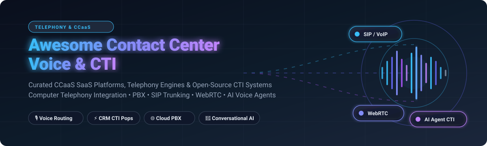

# 📞 Awesome Contact Center Voice & CTI Ecosystem 🎧

**A Curated Directory of CCaaS SaaS Platforms, Telephony Engines, WebRTC Media Servers & Open-Source Computer Telephony Integration (CTI) Frameworks**

*Empowering developers, telecom engineers, and contact center architects to build, integrate, and scale enterprise voice experiences.*

---

## 📑 Table of Contents

- [🔍 Sector Overview & Market Dynamics](#-sector-overview--market-dynamics)
- [☁️ SaaS / Hosted CCaaS Platforms](#️-saas--hosted-ccaas-platforms)
- [💻 Open-Source Telephony & CTI Projects](#-open-source-telephony--cti-projects)
- [📈 Star History](#-star-history)
- [🤝 Contributing](#-contributing)
- [💖 Support & Sponsorship](#-support--sponsorship)
- [⚖️ Disclaimer](#️-disclaimer)

---

## 🔍 Sector Overview & Market Dynamics

The global Contact Center as a Service (CCaaS) and CTI market was valued at approximately **$6.2 billion in 2024** and is projected to surpass **$19.8 billion by 2030**, exhibiting a robust Compound Annual Growth Rate (CAGR) of **19.3%**, driven by cloud migration, omnichannel routing demand, and generative AI agentic automation.

The sector is **moderately fragmented**: mega-cap hyper-scalers and enterprise software giants (Salesforce, AWS, Cisco) dominate global enterprise workflows and CRM hooks, while established pure-play CCaaS leaders (Genesys, Five9, Talkdesk, NICE) compete aggressively on specialized workforce engagement (WEM) and agent copilot intelligence, alongside programmable CPaaS disruptors (Twilio, LiveKit) and vibrant open-source foundations (Asterisk, FreeSWITCH, Kamailio).

---

## ☁️ SaaS / Hosted CCaaS Platforms

Below is a comparison of premier commercial SaaS platforms for contact center voice, CTI, and automated routing, ranked in descending order of vendor scale (market capitalization / valuation):

| Product | Company Size (Valuation / Revenue) | Starting Pricing (Specific Tier) | Free Tier / Free Trial Limits | Key Voice & CTI Features |
| :--- | :--- | :--- | :--- | :--- |
| **[Amazon Connect](https://aws.amazon.com/connect/)** | **~$1.95T Market Cap** (Amazon / AWS; AWS ~$105B+ ARR) | **$0.018 per minute** (Inbound & Outbound US usage-based pricing) + $0.005/min Contact Lens; $0.03/day per claimed DID number | **12-Month AWS Free Tier**: 90 min/mo of Amazon Connect usage, 30 min/mo Contact Lens, and 1 DID number (US region) free for 1 year | Cloud-native CCaaS, Contact Lens AI, CRM CTI integration, dynamic drag-and-drop IVR flows, real-time analytics. |
| **[Salesforce Service Cloud Voice](https://www.salesforce.com/)** | **~$280B Market Cap** (Salesforce FY25 ~$38B Revenue) | **$50/user/month** (Partner Telephony add-on billed annually) or **$75/user/month** (with native AWS Telephony included) | **30-Day Free Trial** of Salesforce Service Cloud (Enterprise edition sandbox with simulated telephony integration testing) | Embedded Service Cloud console CTI, Einstein AI voice transcription, automatic screen pops, click-to-dial. |
| **[Twilio Voice](https://www.twilio.com/voice)** | **~$13B Market Cap** (Twilio ~$4.2B ARR) | **$0.0085 per minute** (Inbound browser/app VoIP) / **$0.014 per minute** (Inbound local number) + $1.15/month per local DID | **$15.00 Free Trial Credit** (No expiration date on credit; includes 1 trial phone number, unrestricted API sandbox testing) | Programmable Voice API, WebRTC SDKs, Elastic SIP Trunking, call recording, Speech-to-Text, custom CTI routing. |
| **[Genesys Cloud CX](https://www.genesys.com/)** | **~$13B Valuation** (Private / Permira; ~$2.5B ARR) | **$75/named user/month** (Cloud CX 1 Voice plan billed annually) | **30-Day Free Trial** (Full access sandbox to Genesys Cloud CX environment with demo queues and WebRTC client) | Omnichannel routing, AI agent assist, workforce engagement management, native CRM CTI for Salesforce and Microsoft Dynamics. |
| **[RingCentral Contact Center](https://www.ringcentral.com/)** | **~$3.2B Market Cap** (RingCentral ~$2.4B ARR) | **$65/agent/month** (RingCX AI-powered CCaaS plan billed annually) | **14-Day Free Trial** (RingCX and RingCentral MVP supporting up to 5 user extensions and 50 call minutes) | Omnichannel ACD, AI virtual agents, smart transcription, deep CTI integration for Salesforce, Zendesk, and ServiceNow. |
| **[Five9](https://www.five9.com/)** | **~$2.8B Market Cap** (Five9 ~$1.0B ARR) | **$149/agent/month** (Core Voice tier billed annually) | **30-Day Guided Proof-of-Concept / Trial** (Vendor-assisted sandbox instance with live agent desktop testing) | Intelligent Cloud Contact Center, IVA conversational AI, predictive dialer, pre-built CTI adapters for Salesforce, ServiceNow, and Oracle. |
| **[8x8 Contact Center](https://www.8x8.com/)** | **~$260M Market Cap** (8x8 ~$730M ARR) | **$85/user/month** (X6 Voice CCaaS plan billed annually) | **30-Day Free Trial** (Trial workspace with softphone WebRTC interface and admin routing tools) | Unified CCaaS and UCaaS, speech analytics, skill-based routing, native Salesforce and Zendesk CTI connector. |
| **[Dialpad Contact Center](https://www.dialpad.com/)** | **~$2.2B Valuation** (Private Series F; ~$300M+ ARR) | **$80/user/month** (Ai Contact Center Essentials tier billed annually) | **14-Day Free Trial** (Includes unlimited calling/SMS within US/Canada, Dialpad Ai live transcription for up to 5 licenses) | Proprietary Dialpad Ai real-time transcription, sentiment analysis, screen pops, Salesforce and Google Workspace CTI. |
| **[Talkdesk](https://www.talkdesk.com/)** | **~$10B Valuation** (Private Series D; ~$500M+ ARR) | **$85/user/month** (CX Cloud Essentials tier billed annually) | **14-Day Free Trial** (Interactive cloud sandbox with access to Talkdesk Studio, demo IVR flows, and agent workspace) | AI-powered Talkdesk Copilot, omnichannel studio, click-to-dial CTI, automated CRM synchronization and screen pops. |
| **[Vonage Contact Center](https://www.vonage.com/)** | **~$6.2B Acquisition Valuation** (Subsidiary of Ericsson) | **$95/agent/month** (Express tier billed annually) | **14-Day Free Trial** (Vonage Business Communications and API developer sandbox with $10 voice credit) | Salesforce-native CTI console integration, omni-channel routing, Vonage AI Virtual Assistant, WebRTC softphone. |

---

## 💻 Open-Source Telephony & CTI Projects

The open-source ecosystem provides transparent, self-hosted, and customizable building blocks—spanning SIP proxies, telephony switches, WebRTC media servers, and real-time AI voice runtimes. Repositories are ranked below in descending order of GitHub stargazers:

| Repository | GitHub_Stars | License | Description & Telephony Capabilities |
| :--- | :---: | :---: | :--- |
| **[chatwoot/chatwoot](https://github.com/chatwoot/chatwoot)** |  | AGPL-3.0 | Open-source customer engagement platform and omnichannel helpdesk with voice channel support, live chat, and CRM integrations. |
| **[jitsi/jitsi-meet](https://github.com/jitsi/jitsi-meet)** |  | Apache-2.0 | High-performance WebRTC video and audio conferencing engine; provides underlying real-time communication infrastructure for contact center video/voice escalations. |
| **[livekit/livekit](https://github.com/livekit/livekit)** |  | Apache-2.0 | Next-generation WebRTC media stack and transport engine optimized for real-time human-to-human and AI-to-human voice agent sessions. |
| **[pipecat-ai/pipecat](https://github.com/pipecat-ai/pipecat)** |  | BSD-2-Clause | Ultra-low latency open-source framework for building conversational voice agents, combining SIP/WebRTC audio with real-time LLMs and TTS/STT pipelines. |
| **[coturn/coturn](https://github.com/coturn/coturn)** |  | BSD-3-Clause | Standard TURN/STUN server essential for establishing peer-to-peer WebRTC voice sessions and bypassing corporate NAT/firewalls in browser-based CTI. |
| **[fonoster/fonoster](https://github.com/fonoster/fonoster)** |  | MIT | The open-source alternative to Twilio. Programmable telecommunications stack with Node.js APIs for voice calls, SMS, and SIP trunking. |
| **[versatica/mediasoup](https://github.com/versatica/mediasoup)** |  | ISC | Cutting-edge WebRTC Selective Forwarding Unit (SFU) library for building custom multi-party voice rooms and high-throughput agent call bridges. |
| **[signalwire/freeswitch](https://github.com/signalwire/freeswitch)** |  | MPL-1.1 | Scalable multi-protocol softswitch and voice router powering carrier-grade contact centers with SIP, WebRTC, IVR, ESL control, and conferencing. |
| **[jitsi/jitsi](https://github.com/jitsi/jitsi)** |  | Apache-2.0 | Classic open-source multi-protocol audio/video SIP and XMPP client; foundational codebase for open desktop telephony integration. |
| **[asterisk/asterisk](https://github.com/asterisk/asterisk)** |  | GPL-2.0 | The grandfather of open-source PBX. Powers millions of telephony lines worldwide with comprehensive ACD queues, IVR, ARI REST APIs, and AMI CTI triggers. |
| **[kamailio/kamailio](https://github.com/kamailio/kamailio)** |  | GPL-2.0 | Carrier-grade SIP proxy handling thousands of call setups per second for large-scale VoIP routing, load balancing, and anti-fraud enforcement. |
| **[versatica/JsSIP](https://github.com/versatica/JsSIP)** |  | MIT | Pure JavaScript SIP library utilizing WebRTC. Enables embedding full-featured softphones and CTI call bars directly into CRM web browsers. |
| **[onsip/SIP.js](https://github.com/onsip/SIP.js)** |  | MIT | Rich JavaScript SIP stack written in TypeScript; powers browser-based WebRTC softphones, agent screens, and web dialers. |
| **[fonoster/routr](https://github.com/fonoster/routr)** |  | Apache-2.0 | Lightweight, programmable SIP server and location proxy designed for cloud-native microservices and multi-tenant voice routing. |
| **[OpenSIPS/opensips](https://github.com/OpenSIPS/opensips)** |  | GPL-2.0 | High-performance SIP routing engine supporting dynamic routing, SIP trunk load balancing, fraud detection, and multi-tenant contact centers. |
| **[BelledonneCommunications/linphone-android](https://github.com/BelledonneCommunications/linphone-android)** |  | AGPL-3.0 | Android client implementation of Linphone SIP phone, showcasing mobile CTI, crystal-clear audio codecs, and secure voice communication. |
| **[fusionpbx/fusionpbx](https://github.com/fusionpbx/fusionpbx)** |  | MPL-1.1 | Feature-rich web-based administration GUI for FreeSWITCH with multi-tenant domain isolation, ACD queues, IVR builders, and CDR reporting. |
| **[sipwise/rtpengine](https://github.com/sipwise/rtpengine)** |  | GPL-3.0 | Kernel-accelerated RTP and WebRTC media proxy for Kamailio and OpenSIPS, handling media transcoding, DTLS encryption, and ICE traversal. |
| **[unpod-ai/unpod](https://github.com/unpod-ai/unpod)** |  | Apache-2.0 | Open-source CPaaS for AI contact center agents utilizing LiveKit, Pipecat, LangChain, and Django to deliver autonomous phone triage. |
| **[FreePBX/framework](https://github.com/FreePBX/framework)** |  | GPL-3.0 | Modular core framework for FreePBX, simplifying Asterisk configuration with web GUI controls for ring groups, IVRs, and extensions. |
| **[ictinnovations/ictcrm](https://github.com/ictinnovations/ictcrm)** |  | AGPL-3.0 | SuiteCRM enhancement adding Asterisk/FreeSWITCH CTI capabilities, auto-dialers, contact center campaign tracking, and WebRTC dialing. |
| **[nextgenswitch/nextgenswitch](https://github.com/nextgenswitch/nextgenswitch)** |  | GPL-3.0 | Next-generation softswitch and cloud PBX framework featuring AI IVR workflows, programmable Voice APIs, and multi-tenant billing. |
| **[wazo-platform/wazo-platform](https://github.com/wazo-platform/wazo-platform)** |  | GPL-3.0 | Fully programmable, API-first communication platform built on Asterisk for deploying modern telephony and call center infrastructure. |
| **[dialplane/dialplane](https://github.com/dialplane/dialplane)** |  | Apache-2.0 | Pure-Python async SIP/RTP engine for AI voice agents, enabling direct audio stream ingestion into Python AI frameworks without extra per-minute fees. |

---

## 📈 Star History

---

## 🤝 Contributing

Contributions are welcome and appreciated! To add a new SaaS platform, open-source telephony framework, or CTI tool:

1. **Fork** the repository 🍴
2. **Create a branch** for your updates (`git checkout -b feat/add-new-cti-tool`) 🌿
3. **Add your entry** keeping tables sorted according to established metrics (Company Valuation for SaaS; GitHub_Stars for Open-Source) 📝
4. **Follow the formatting guidelines**: include clear links, specific pricing tiers, trial constraints, and licenses 🎯
5. **Open a Pull Request** with a brief summary of the project and why it belongs in the list 🚀

---

## 💖 Support & Sponsorship

Thank you for exploring and bookmarking the **Awesome Contact Center Voice & CTI** list! ⭐ If you find this resource useful for your engineering work or telecom architecture:

- **Star this repository** to help others discover it ⭐
- **Fork and share** it with fellow telecom and CTI developers 🌐
- Consider supporting ongoing maintenance by buying a coffee on the [**GitHub Sponsors Dashboard**](https://github.com/sponsors/ishandutta2007) ☕

---

## ⚖️ Disclaimer

- This list is **community-curated** for educational, engineering, and informational purposes and does not imply vendor endorsement.
- Contact center voice platforms processing customer communications and biometric voice prints must strictly comply with regional regulatory standards including **GDPR**, **TCPA**, **HIPAA**, and **PCI-DSS**.
- Deploying self-hosted open-source telephony systems in production requires dedicated SIP firewall hardening, TLS/SRTP configuration, and high-availability session border controllers (SBCs).
